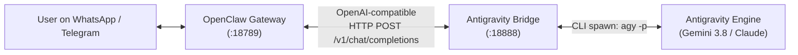

# How to Connect Google Antigravity with OpenClaw

This guide explains how to connect **Google Antigravity** with **OpenClaw** to power a multi-channel personal AI assistant (WhatsApp, Telegram, Discord, webhooks) using Antigravity's built-in models (such as Gemini 3.8 Flash and Claude Sonnet) without needing paid API keys from OpenAI, Anthropic, or external providers.

---

## Architecture Overview



1. **User Surface (WhatsApp / Telegram / Web)**: Messages arrive at the OpenClaw Gateway.
2. **OpenClaw Gateway**: Manages sessions, memory (`MEMORY.md`), channels, and browser tools. It delegates LLM inference to a custom OpenAI-compatible endpoint.
3. **Antigravity Bridge (`antigravity-bridge.mjs`)**: A lightweight local HTTP service running on port `18888`. It translates `/v1/chat/completions` requests into Antigravity CLI (`agy`) prompts with automatic sliding-window context truncation.
4. **Antigravity Engine**: Executes the reasoning and response generation via Google's model backend and returns the output to the bridge.

---

## Prerequisites

1. **Operating System**: Linux (Ubuntu 22.04+ recommended) or macOS.
2. **Antigravity CLI (`agy`)**: Installed and working in your terminal (`agy --version`).
3. **Node.js**: Version **v24.16+** (v24.22.0 LTS recommended). OpenClaw requires Node 24+ for WAL-reset-safe `node:sqlite`.
   ```bash
   # Install via nvm if needed
   nvm install 24.22.0
   nvm alias default 24.22.0
   ```

---

## Step 1: Install OpenClaw

Install OpenClaw globally using npm or the official installer:

```bash
# Using official script without launching interactive onboarding immediately
curl -fsSL https://openclaw.ai/install.sh | bash -s -- --install-method npm --no-onboard --no-prompt
```

Create an executable wrapper at `~/.local/bin/openclaw` to ensure it always runs with Node 24:

```bash
cat << 'EOF' > ~/.local/bin/openclaw
#!/usr/bin/env bash
export PATH="$HOME/.nvm/versions/node/v24.22.0/bin:$PATH"
exec "$HOME/.nvm/versions/node/v24.22.0/bin/openclaw" "$@"
EOF

chmod +x ~/.local/bin/openclaw
```

Initialize the baseline directories and configuration:

```bash
openclaw setup --baseline
```

---

## Step 2: Create the Antigravity Local Bridge Server

Create the directory and bridge script at `~/.openclaw/bridges/antigravity-bridge.mjs`:

```bash
mkdir -p ~/.openclaw/bridges
```

Write the bridge server code:

```javascript
import http from "node:http";
import { spawn } from "node:child_process";

const PORT = 18888;
const HOST = "127.0.0.1";

// Safe character budget to avoid Linux MAX_ARG_STRLEN (128 KB) E2BIG errors
const MAX_PROMPT_CHARS = 65000;
const MAX_SYSTEM_CHARS = 20000;

function runAntigravity(prompt) {
  return new Promise((resolve, reject) => {
    const agy = spawn("agy", ["--output-format", "json", "-p", prompt], {
      env: process.env,
    });

    let stdout = "";
    let stderr = "";

    agy.stdout.on("data", (chunk) => {
      stdout += chunk;
    });

    agy.stderr.on("data", (chunk) => {
      stderr += chunk;
    });

    agy.on("error", (err) => {
      console.error("[Bridge] spawn error:", err);
      reject(err);
    });

    agy.on("close", (code) => {
      if (code !== 0) {
        console.error(`[Bridge] agy exited with code ${code}: ${stderr}`);
        return reject(new Error(stderr || `agy exited with code ${code}`));
      }
      try {
        const parsed = JSON.parse(stdout);
        resolve(parsed.response || "");
      } catch (err) {
        resolve(stdout || "");
      }
    });
  });
}

function buildPrompt(messages) {
  let systemText = "";
  const conversationMessages = [];

  for (const msg of messages) {
    const role = msg.role;
    let content = typeof msg.content === "string" ? msg.content : JSON.stringify(msg.content);
    if (!content) continue;

    if (role === "system") {
      if (systemText) systemText += "\n";
      systemText += content;
    } else {
      conversationMessages.push({ role, content });
    }
  }

  if (systemText.length > MAX_SYSTEM_CHARS) {
    systemText = systemText.slice(-MAX_SYSTEM_CHARS);
  }

  let formattedSystem = systemText ? `[System Instruction: ${systemText}]\n\n` : "";
  const remainingBudget = Math.max(10000, MAX_PROMPT_CHARS - formattedSystem.length - 100);

  // Collect most recent messages up to the character budget
  const selected = [];
  let currentLen = 0;

  for (let i = conversationMessages.length - 1; i >= 0; i--) {
    const msg = conversationMessages[i];
    const prefix = msg.role === "user" ? "User: " : msg.role === "assistant" ? "Assistant: " : `${msg.role}: `;
    const line = `${prefix}${msg.content}\n`;
    if (currentLen + line.length > remainingBudget && selected.length > 0) {
      break;
    }
    selected.unshift(line);
    currentLen += line.length;
  }

  return `${formattedSystem}${selected.join("")}\nRespond as the Assistant directly and concisely:`;
}

const server = http.createServer(async (req, res) => {
  res.setHeader("Access-Control-Allow-Origin", "*");
  res.setHeader("Access-Control-Allow-Methods", "GET, POST, OPTIONS");
  res.setHeader("Access-Control-Allow-Headers", "Content-Type, Authorization");

  if (req.method === "OPTIONS") {
    res.writeHead(200);
    return res.end();
  }

  const url = new URL(req.url, `http://${req.headers.host || HOST}`);

  // Health endpoint
  if (url.pathname === "/" || url.pathname === "/health") {
    res.writeHead(200, { "Content-Type": "application/json" });
    return res.end(JSON.stringify({ status: "ok", provider: "antigravity" }));
  }

  // Model catalog
  if (url.pathname === "/v1/models" || url.pathname === "/models") {
    res.writeHead(200, { "Content-Type": "application/json" });
    return res.end(
      JSON.stringify({
        object: "list",
        data: [
          {
            id: "antigravity",
            object: "model",
            created: Math.floor(Date.now() / 1000),
            owned_by: "antigravity",
          },
        ],
      })
    );
  }

  // Chat completions
  if (url.pathname === "/v1/chat/completions" || url.pathname === "/chat/completions") {
    if (req.method !== "POST") {
      res.writeHead(405, { "Content-Type": "application/json" });
      return res.end(JSON.stringify({ error: "Method Not Allowed" }));
    }

    let body = "";
    req.on("data", (chunk) => {
      body += chunk;
    });

    req.on("end", async () => {
      try {
        const payload = JSON.parse(body || "{}");
        const messages = payload.messages || [];
        const isStreaming = Boolean(payload.stream);
        const reqModel = payload.model || "antigravity";

        const promptText = buildPrompt(messages);
        let answer = "";
        try {
          answer = await runAntigravity(promptText);
        } catch (execErr) {
          console.error("[Bridge] Execution failed:", execErr);
          answer = "Temporary processing glitch. Please retry your request.";
        }

        if (isStreaming) {
          res.writeHead(200, {
            "Content-Type": "text/event-stream",
            "Cache-Control": "no-cache",
            "Connection": "keep-alive",
          });

          const chunkId = `chatcmpl-${Date.now()}`;
          const timestamp = Math.floor(Date.now() / 1000);

          res.write(
            `data: ${JSON.stringify({
              id: chunkId,
              object: "chat.completion.chunk",
              created: timestamp,
              model: reqModel,
              choices: [{ index: 0, delta: { role: "assistant", content: answer }, finish_reason: null }],
            })}\n\n`
          );

          res.write(
            `data: ${JSON.stringify({
              id: chunkId,
              object: "chat.completion.chunk",
              created: timestamp,
              model: reqModel,
              choices: [{ index: 0, delta: {}, finish_reason: "stop" }],
            })}\n\n`
          );
          res.write("data: [DONE]\n\n");
          return res.end();
        } else {
          res.writeHead(200, { "Content-Type": "application/json" });
          return res.end(
            JSON.stringify({
              id: `chatcmpl-${Date.now()}`,
              object: "chat.completion",
              created: Math.floor(Date.now() / 1000),
              model: reqModel,
              choices: [{ index: 0, message: { role: "assistant", content: answer }, finish_reason: "stop" }],
              usage: {
                prompt_tokens: Math.ceil(promptText.length / 4),
                completion_tokens: Math.ceil(answer.length / 4),
                total_tokens: Math.ceil((promptText.length + answer.length) / 4),
              },
            })
          );
        }
      } catch (err) {
        console.error("[Bridge] Unhandled error:", err);
        res.writeHead(500, { "Content-Type": "application/json" });
        return res.end(JSON.stringify({ error: { message: err.message } }));
      }
    });
    return;
  }

  res.writeHead(404, { "Content-Type": "application/json" });
  res.end(JSON.stringify({ error: "Not Found" }));
});

server.listen(PORT, HOST, () => {
  console.log(`[Antigravity Bridge] Listening on http://${HOST}:${PORT}`);
});
```

---

## Step 3: Run the Bridge as a Background Service

Create a systemd user unit at `~/.config/systemd/user/antigravity-bridge.service`:

```ini
[Unit]
Description=Antigravity OpenAI Bridge Service
After=network.target

[Service]
Type=simple
ExecStart=/home/sonu179208/.nvm/versions/node/v24.22.0/bin/node /home/sonu179208/.openclaw/bridges/antigravity-bridge.mjs
Restart=always
RestartSec=3
Environment=HOME=/home/sonu179208
Environment=PATH=/home/sonu179208/.local/bin:/home/sonu179208/.nvm/versions/node/v24.22.0/bin:/usr/local/bin:/usr/bin:/bin

[Install]
WantedBy=default.target
```

Enable and start the service:

```bash
systemctl --user daemon-reload
systemctl --user enable --now antigravity-bridge.service
systemctl --user status antigravity-bridge.service
```

Verify that the bridge is responding:

```bash
curl http://127.0.0.1:18888/health
# Output: {"status":"ok","provider":"antigravity"}
```

---

## Step 4: Configure OpenClaw to Use Antigravity

Add the custom provider and set it as the default model in `~/.openclaw/openclaw.json`:

```json
{
  "models": {
    "mode": "merge",
    "providers": {
      "antigravity": {
        "baseUrl": "http://127.0.0.1:18888/v1",
        "apiKey": "antigravity-local-key",
        "api": "openai-completions",
        "models": [
          {
            "id": "antigravity",
            "name": "Antigravity Bridge",
            "reasoning": false,
            "input": ["text"],
            "contextWindow": 128000,
            "maxTokens": 8192
          }
        ]
      }
    }
  },
  "agents": {
    "defaults": {
      "model": {
        "primary": "antigravity/antigravity"
      }
    }
  }
}
```

Verify the configuration:

```bash
openclaw config validate
openclaw models status
```

---

## Step 5: Start the OpenClaw Gateway Service

Install and start the OpenClaw Gateway as a persistent systemd user service:

```bash
openclaw gateway install --wrapper ~/.local/bin/openclaw --runtime-path $(which node)
systemctl --user start openclaw-gateway.service
```

Test a turn via the CLI:

```bash
openclaw agent --message "Respond with: Hello from Antigravity"
```

---

## Step 6: Connect WhatsApp (Optional)

1. Run the channel login wizard:
   ```bash
   openclaw channels login --channel whatsapp
   ```
2. Scan the generated QR code using WhatsApp on your phone (**Linked Devices**).
3. Check channel health:
   ```bash
   openclaw channels status
   ```
4. **Security & Allowlist**: By default, OpenClaw sets `selfChatMode: true` and `dmPolicy: "allowlist"`, meaning it will only respond to your personal "Message yourself" chat and ignore third parties. You can authorize additional numbers:
   ```bash
   openclaw config set channels.whatsapp.allowFrom '["918437179208", "+917355469278"]'
   ```

---

## Troubleshooting & Key Invariants

> [!IMPORTANT]
> **Linux `E2BIG` (Argument list too long)**:  
> When passing prompts to `spawn("agy", ["-p", prompt])`, Linux enforces a strict `MAX_ARG_STRLEN` limit of 128 KB. If conversations become long without truncation, the system will fail with `code: 'E2BIG'`. The bridge includes sliding-window truncation to keep prompt sizes safely under 65,000 characters.

> [!NOTE]
> **Switching Under-the-Hood Models**:  
> By default, `agy -p` invokes `gemini-3.8-flash-high`. To change the underlying Antigravity model (for example to `claude-sonnet-4-6`), add `--model claude-sonnet-4-6` to the `spawn` arguments inside `antigravity-bridge.mjs` and restart `antigravity-bridge.service`.
